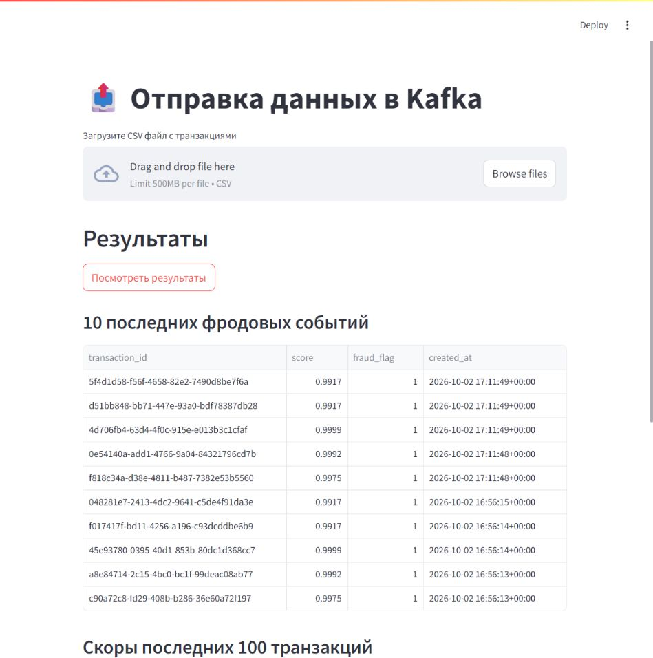
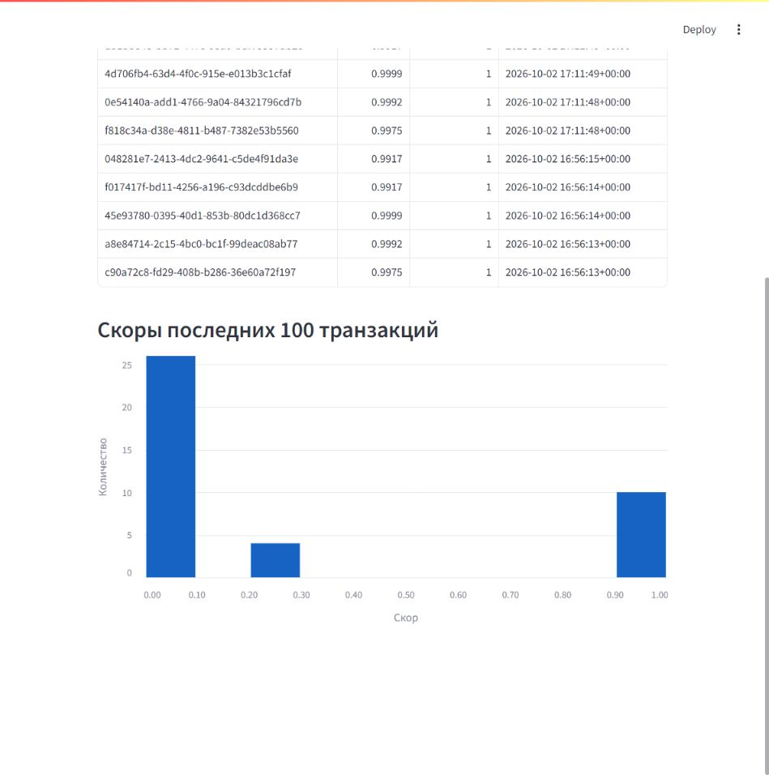

# Проверка транзакций

Работу сделал Калабай Михаил. Как и просили в условиях, в данном доработанном проекте можно загрузить CSV с транзакциями, отправить его на проверку и посмотреть результаты обработки транзакций на фродовость. Опять же, как и просилось, модель считает скор на CPU, всё проходит через Kafka и сохраняется в PostgreSQL (то есть делал и дополнительные пункты про базу и результаты).

## Как запустить

Я запускал через Docker Desktop с WSL 2. Нужен Docker с Compose, и контейнеры там должны быть Linux. Использовал порты 8501, 8081, 9095 и 2181 (можно поменять настройки порта в `docker-compose.yaml`).

Понятное дело над скачать `train.csv` и `test.csv` из [соревнования](https://www.kaggle.com/competitions/teta-ml-1-2025/data), иначе не заработает. `train.csv` кладём в `fraud_detector/train_data/`, а `test.csv` в `data/`. Если папок нет, создаём. Для скачивания на Kaggle нужен вход и принятие правил.

Запуск из папки проекта:

```bash
docker compose up -d --build
docker compose ps
```

Первый запуск может занять несколько минут. Библиотеки установятся при сборке. `kafka-setup` после создания топиков завершится с кодом 0, это нормально.

Если с дефолт портами, то приложение тут: http://localhost:8501. Посмотреть Kafka можно здесь: http://localhost:8081.

## Как проверить

В приложении выбираем CSV с колонками как в `test.csv` и нажимаем кнопку отправки.

По кнопке «Посмотреть результаты» можно увидеть таблицу последних 10 транзакций с фродом, на графике скоры последних 100 транзакций, в том числе обычных (как на скринах ниже). Если в базе меньше 100, на графике будут все сколько есть.

Ещё мини тест:

```bash
docker compose exec interface python smoke_test.py
```

Отправляет 10 строк из `test.csv` и ждёт до 3 минут. Если всё норм, напишет `test ok: 10 results saved`. Результаты останутся в базе.

Логи:

```bash
docker compose logs --tail 50 fraud_detector score_writer interface
```

## Как остановить

```bash
docker compose down
```

## Что происходит внутри

Модель CatBoost лежит в `fraud_detector/models/my_catboost.cbm`. Сама модель и препроцессинг остались с семинара 1 в 1. В коде вызова модели немного поменялся подсчёт: скор считается один раз, на двух CPU потоках. При запуске обучения нет, `train.csv` нужен для признаков.

Порог остался тем же 0.98. Флаг фрода ставится, если скор больше него.

Строки CSV отправляются в топик `transactions`. Сервис скоринга берёт оттуда транзакцию, готовит признаки и передаёт их модели. Потом отправляет результат в топик `scores`. Его читает `score_writer` и сохраняет результат в PostgreSQL. В результате три поля: `transaction_id`, `score`, `fraud_flag`. Ну и там проверки, чтобы скор был от 0 до 1, флаг 0 или 1 и один ID не записывался дважды.

## Что в каких файлах

Ну тут по файлам примерно так. В `fraud_detector/app/app.py` всё с Kafka: берём транзакцию и потом отправляем результат. В `fraud_detector/src/preprocessing.py` готовим признаки, а в `fraud_detector/src/scorer.py` уже вызываем модель и получаем скор.

`score_writer/app.py` просто берёт готовые результаты и пишет их в базу. Саму таблицу создаём через `db/init.sql`.

Всё, что видно на странице, лежит в `interface/app.py`. А чтобы достать результаты из базы для таблицы и графика, есть `interface/results.py`.

Ну и `docker-compose.yaml`, чтобы всё это вместе запускалось. Dockerfile и requirements лежат в папках самих сервисов.

После `docker compose down` результаты из базы не пропадают, они остаются в volume `pgdata`. Если тот же CSV отправить ещё раз через интерфейс, будут новые ID и он обработается заново.

## Скриншоты

Тут в базе 40 результатов после тестовых отправок. Для примера отправлял в том числе транзакции с высоким скором, это не график по всему датасету.




